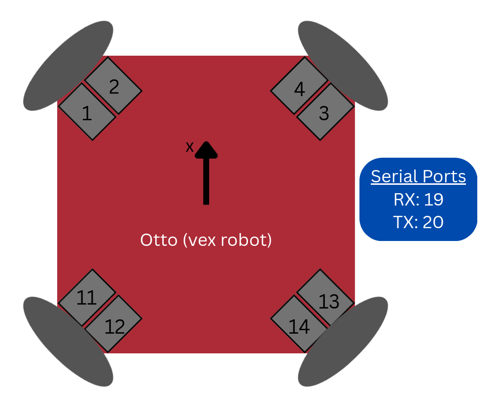

# v5_bridge (C++ / PROS)
A VEX Brain program that receives velocity commands and transmits position and velocity information. Works together with [`Autonomous-VEXU/otto_hardware`](https://github.com/Autonomous-VEXU/otto_hardware.git) and [`Autonomous-VEXU/otto_bringup`](https://github.com/Autonomous-VEXU/otto_bringup.git).

This is a C++ port of the original Rust/vexide `v5_bridge`, built on [PROS 4](https://pros.cs.purdue.edu/).

### Layout
| File | Purpose |
| --- | --- |
| `include/bridge/protocol.hpp` | Magic numbers and the 36-byte `MotorPacket` shared with `otto_hardware` |
| `include/bridge/transport.hpp` | USB serial (default) and smart-port serial transports |
| `src/main.cpp` | Motor setup, packet parsing, unit conversion, and the bridge loop |

### Protocol
Every packet is a packed, little-endian `MotorPacket`: an 8-byte magic followed by seven `float`s
(`front_left`, `front_right`, `back_left`, `back_right`, `intake1..3`).

| Magic | Direction | Meaning |
| --- | --- | --- |
| `0xFEFAABCD1234BEEF` | host → brain | Wheel/intake velocity commands, rad/s |
| `0xABCD5869B0B1CCCC` | host → brain | Reset encoders (bare 8-byte magic, no payload) |
| `0xF23BDEAD6789ACBD` | brain → host | Positions, rad |
| `0xF81CB3924EA7C0CA` | brain → host | Velocities, rad/s |

Each loop the brain waits up to 100 ms for a command (keeping only the newest if several are queued),
applies it, then sends one position and one velocity packet.

### Transport
By default the bridge uses the USB cable (the brain's user serial port, usually `/dev/ttyACM1`).
To use the comms board on smart ports 20 (rx) and 19 (tx) at 115200 baud instead, set
`BRIDGE_USE_SMART_PORT_SERIAL` to `1` in `src/main.cpp`.

### VEX brain port configuration
Otto's current configuration with the ports labeled on the relative motor.



### Compiling and uploading to a VEX V5 robot
Install the [PROS CLI and toolchain](https://pros.cs.purdue.edu/v5/getting-started/index.html).
This folder holds only the project's own sources, so create the PROS kernel files once:

```console
pros conductor new-project v5_bridge_tmp
```

Copy `v5_bridge_tmp`'s `firmware/`, `include/` (everything except `include/bridge/`), `Makefile`,
`common.mk` and `project.pros` into this folder, keeping this folder's `src/main.cpp`.

Then build and upload:

```console
pros make
pros upload --slot 1
```

### Viewing program output
The bridge disables PROS's COBS stream encoding so the host sees raw packets, which means
`pros terminal` will show packet bytes rather than text. The brain's screen shows the
latest positions and velocities.
